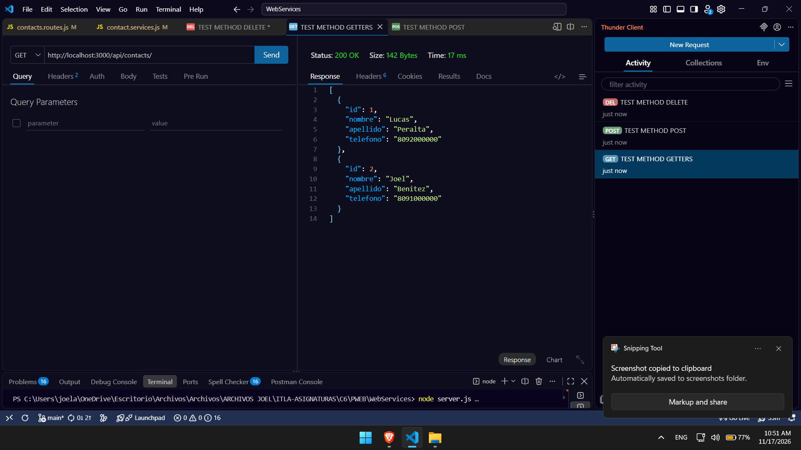
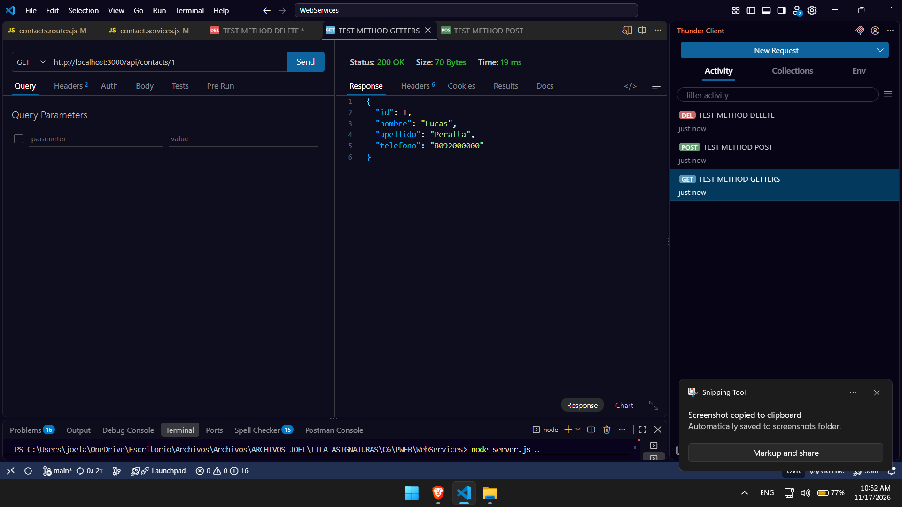
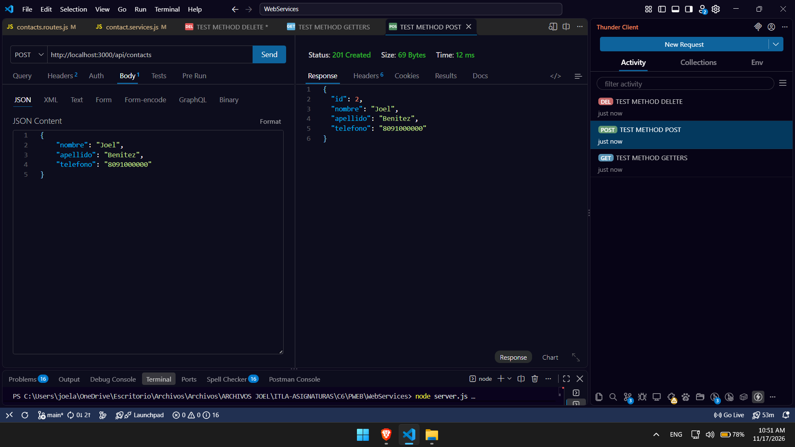
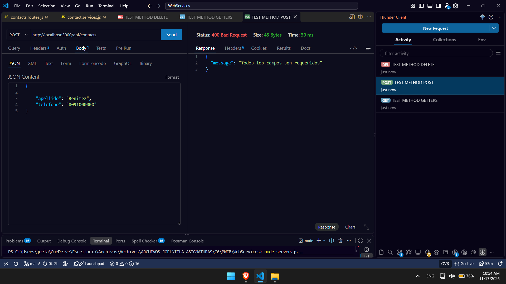
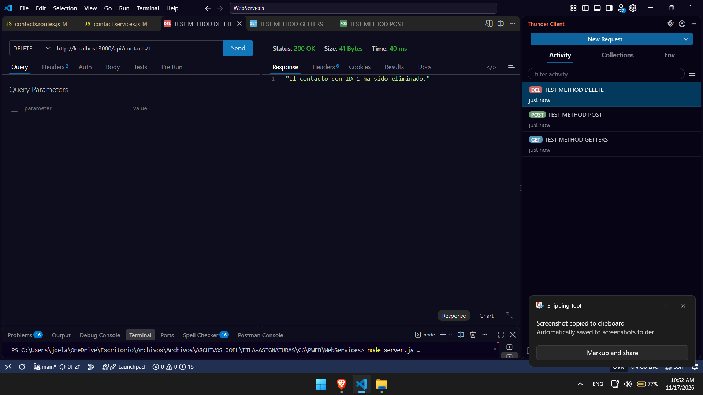
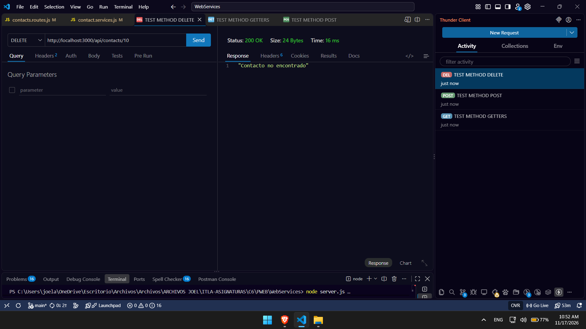
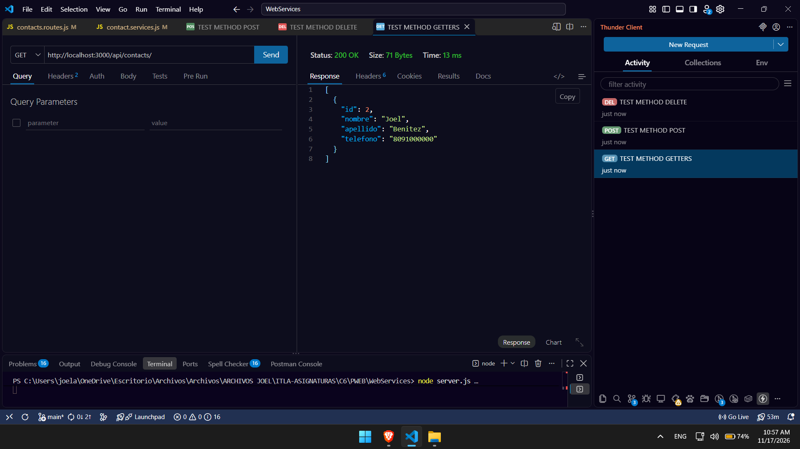
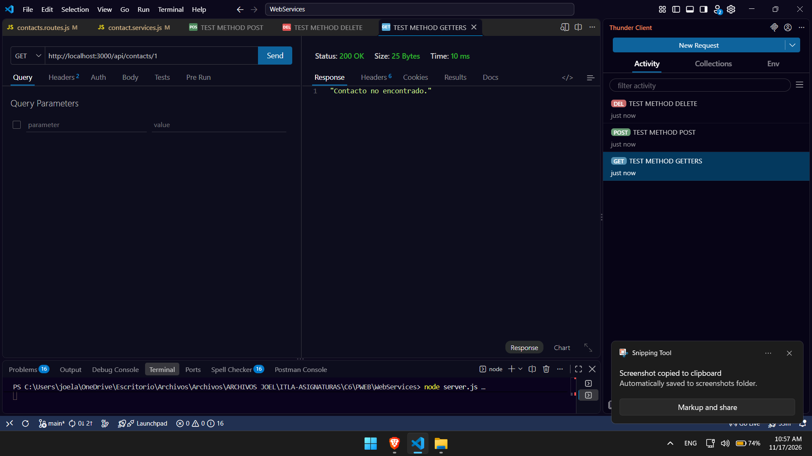

# Información del Proyecto

- **Asignatura:** Programación Web
- **Institución:** Instituto Tecnológico de las Américas (ITLA)
- **Profesor:** Raydelto Hernández Perera
- **Autor:** Joel Alberto Benítez
- **Proyecto:**  Servicio Web desarrollado con `Express` && `Node.js`

# Descripción

Este es un servicio web creado con express y node.js a modo de entrega de la asignatura de programación web del Instituto Tecnológico de las Américas ITLA. En entrega de la tarea 5 que consiste en la realización de un servicio web con las tecnologías antes mencionadas.

Esta tarea parte del servicio usado en las actividades anteriores `https://www.raydelto.org/itla/agenda/` el cual contiene un metodo `Get` para obtener el listado de contactos y `POST` para el registro de nuevos contactos.

# Tecnologías y lenguajes usados

- Express
- Node.js
- Thunder Client
- JavaScript
- Git

# Evidencias de Funcionamiento

## Metodos/Rutas Getter

----

## Metodo/Ruta Post

----

;

## Metodo/Ruta Delete (EXTRA)

----

----

---- 

